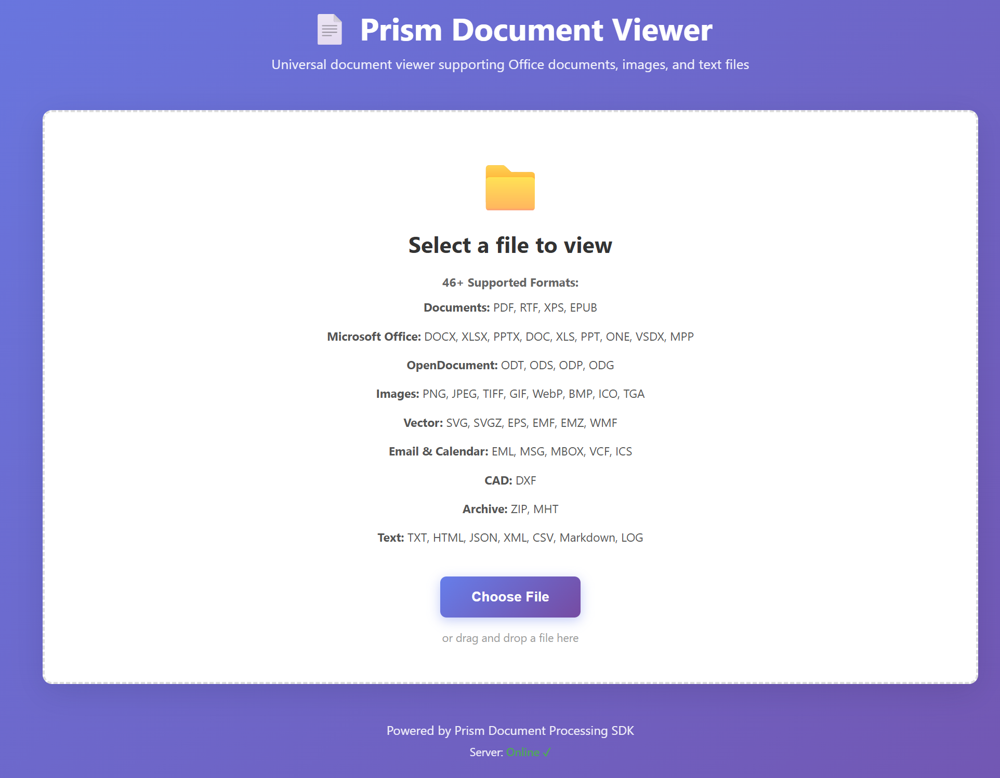
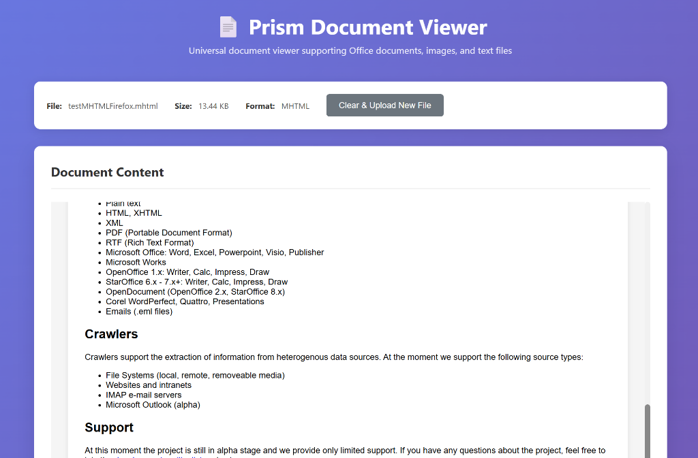
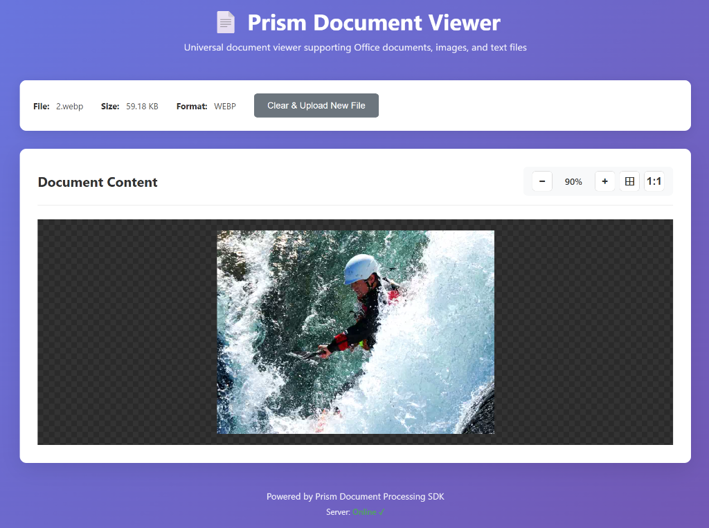

# Prism - Modern Document Processing SDK

> **"Any document, any platform, in milliseconds."**

Prism is an embeddable, pure-Rust document viewing, review, and production SDK built as a modern, memory-safe alternative to **Oracle Outside In Technology (OIT)** for forensic and eDiscovery applications.

Prism combines broad format detection and extraction (68+ formats) with a deterministic, cross-platform native page layout engine (`prism-layout`), dedicated high-fidelity Office engines (`prism-word`, `prism-ppt`, `prism-excel`, `prism-drawingml`, `prism-numfmt`), pure-Rust PDF interpretation (`hayro`), destructive vector/pixel/cell/metadata redaction (`prism-review`), Bates-numbered TIFF/PNG/PDF/PDF-A productions (`prism-production`), and OS-hardened worker process isolation (`prism-sandbox`).

See [docs/ROADMAP.md](docs/ROADMAP.md) for what each phase has done and what is still pending.

## 🖼️ Visuals

<p align="center">
  
</p>

<p align="center">
  
  
</p>

## 🚀 Features

- **Deterministic Native Layout Engine (`prism-layout`)**:
  - Cross-OS identical typography and pagination powered by `fontique`, `parley`, `harfrust`, and `skrifa` with bundled metric-compatible SIL OFL fonts (Carlito, Caladea, Liberation, Noto) and embedded document font support (`.odttf` deobfuscation, PDF embedded fonts).
  - Outputs positioned `LayoutDocument` pages to SVG + selectable text layers, deterministic PNG / multi-page TIFF (`tiny-skia`), and searchable PDF / PDF/A-2b (`krilla`).
- **Dedicated Office & PDF Engines**:
  - **Word (`prism-word`)**: `.docx` and binary `[MS-DOC]` `.doc` with style inheritance, numbering/lists, multi-column sections, headers/footers, footnotes/endnotes, complex tables, anchored images/shapes, tracked changes (`w:ins`, `w:del`, `w:moveFrom`, `w:moveTo`), comments, and forensic metadata.
  - **PowerPoint (`prism-ppt`)**: `.pptx` and binary `[MS-PPT]` `.ppt` with master → layout → slide placeholder inheritance, `DrawingML` themes/shapes/charts/SmartArt, tables, speaker notes, comments, and hidden slides.
  - **Excel (`prism-excel`, `prism-numfmt`)**: `.xlsx` and BIFF8 `.xls` with sparse `Workbook` storage, ECMA-376 number format engine, stored-value conditional formatting, hidden sheets/rows/columns, merged cells, comments, and paginated print layout.
  - **PDF (`prism-layout::pdf_input`)**: Pure-Rust PDF interpretation via `hayro` into the unified `LayoutDocument` page model.
- **68+ Supported Formats**:
  - **Documents**: PDF, RTF, XPS, EPUB
  - **Microsoft Office**: DOCX, XLSX, PPTX, DOC, XLS, PPT, ONE, VSDX, MPP
  - **OpenDocument**: ODT, ODS, ODP, ODG
  - **Images**: PNG, JPEG, JPEG 2000, TIFF, GIF, WebP, BMP, ICO, CUR, TGA, PSD, PCX, WBMP
  - **Vector & CAD**: SVG, SVGZ, EPS, EMF, EMZ, WMF, AI, DXF
  - **Email & Calendar**: EML, MSG, MBOX, VCF, ICS, MHT
  - **Archives**: ZIP, TAR, GZIP, 7z, Bzip2, UNIX Compress (`.Z`)
  - **Database & Code**: SQLite, DBF, TXT, HTML, JSON, XML, CSV, Markdown, LOG, and syntax-highlighted source code
- **eDiscovery Review & Production**:
  - **Hidden-Content & Forensic Inspector**: Automated reporting of tracked changes, comments, hidden text/slides/sheets/rows/columns, very-hidden sheets, white-on-white text, external links, macros, and metadata anomalies (`prism-core::review`, `prism-parsers::review`).
  - **Container Family Tree**: Bounded, cycle-safe enumeration and extraction of archives, email attachments, OLE object pools, OOXML embedded packages, and PDF embedded files (`prism-parsers::tree`).
  - **Annotations & Destructive Redaction (`prism-review`)**: External JSON sidecar (`AnnotationSidecar`), text-anchored cross-version resolution, proposed vs. approved workflow, physical removal of glyph runs, raster pixels, spreadsheet cells/formulas/comments, and metadata, plus automated post-export verification (`verify_redacted_output`).
  - **Bates Productions (`prism-production`)**: Configurable Bates numbering, 6-position endorsements, exception/placeholder slip sheets, TIFF/PNG/PDF/PDF-A-2b output, Concordance `.dat` / Opticon `.opt` / CSV load files, and resumable `production-manifest.json` state.
- **Process-Isolated Sandboxing (`prism-sandbox`, `prism-worker`)**:
  - Warm out-of-process worker pool communicating over length-prefixed stdin/stdout frames with per-job heap limits (`CountingAlloc`), wall-clock timeouts, Windows Job Objects (`JOB_OBJECT_LIMIT_KILL_ON_JOB_CLOSE`, active process & memory limits), and Linux `PR_SET_NO_NEW_PRIVS` + `RLIMIT_AS`/`RLIMIT_CORE`.

## 📦 Workspace Crates

| Crate | Description | Status ([roadmap](docs/ROADMAP.md)) |
|-------|-------------|--------|
| [`prism-core`](crates/prism-core) | Unified Document Model (UDM), format detection, error types, review & cache primitives | ✅ Complete |
| [`prism-layout`](crates/prism-layout) | Native page layout engine (`LayoutDocument`), font shaping, SVG/PNG/TIFF/PDF/PDF-A export, PDF input | ✅ Phase 1 complete |
| [`prism-word`](crates/prism-word) | Word model, `.docx` and binary `.doc` readers, paginated flow layout | 🚧 Phases 2, 8 |
| [`prism-ppt`](crates/prism-ppt) | PowerPoint model, `.pptx` and binary `.ppt` readers, slide/master/layout compositor | 🚧 Phase 3 |
| [`prism-excel`](crates/prism-excel) | Excel model, `.xlsx` and BIFF8 `.xls` readers, paginated sheet print layout | 🚧 Phases 3, 6, 8 |
| [`prism-drawingml`](crates/prism-drawingml) | Shared Office `DrawingML` themes, preset/custom geometry, fills, strokes, and charts | 🚧 Phases 3, 8 |
| [`prism-numfmt`](crates/prism-numfmt) | ECMA-376 Excel number format interpreter (dates, currencies, fractions, scientific, colours) | 🚧 Phase 3 |
| [`prism-parsers`](crates/prism-parsers) | 68+ format parsers, hidden-content inspection providers, container family tree | 🚧 Phases 4, 7, 8 |
| [`prism-render`](crates/prism-render) | Sanitized, CSP-locked HTML renderer and offline viewer bundle | ✅ Complete |
| [`prism-review`](crates/prism-review) | Annotation sidecars, text anchor resolution, destructive redaction & verification, content-addressed artifact cache | 🚧 Phase 4 |
| [`prism-production`](crates/prism-production) | Bates stamping, endorsements, slip sheets, PDF/TIFF/PNG productions, `.dat`/`.opt`/`.csv` load files | 🚧 Phases 4, 6 |
| [`prism-sandbox`](crates/prism-sandbox) | Out-of-process worker pool manager and stateful worker sessions | 🚧 Phases 4, 5 |
| [`prism-worker`](crates/prism-sandbox/src/bin/prism-worker.rs) (binary in `prism-sandbox`) | Hardened sandbox worker binary with custom heap-cap allocator and OS resource limits | 🚧 Phase 4 |
| [`prism-bindings`](crates/prism-bindings) | C ABI (`prism.h`) and .NET P/Invoke (`Prism.Native`) for page-on-demand viewing, workbooks, review & export | 🚧 Phases 2–6 |
| [`prism-cli`](crates/prism-cli) | Command-line tool (`detect`, `info`, `text`, `render`, `export`, `report`, `tree`, `produce`, `verify-redactions`) | ✅ Complete |
| [`prism-server`](crates/prism-server) | Hardened Axum REST API server backed by `prism-sandbox` worker pool | ✅ Complete |

## 🛠️ Installation & Build

### Prerequisites

- Rust 1.88 or later (Edition 2024)
- Cargo

### Building from Source

```bash
# Clone the repository
git clone https://github.com/abahjat/prism.git
cd prism

# Build all workspace crates and binaries (prism, prism-worker, prism-server)
cargo build --release

# Run the full test suite
cargo test --workspace
```

After building, you will find the binaries in `target/release/`:
- `prism` — CLI tool (`prism-cli`)
- `prism-worker` — Sandbox worker process (`prism-worker`)
- `prism-server` — REST API server (`prism-server`)

## 🚀 Quick Start

### Using the CLI (`prism`)

By default, `prism` executes document jobs inside isolated `prism-worker` subprocesses (pass `--in-process` for debugging). All commands support `--json` for machine-readable output and `--cache-dir <DIR>` for content-addressed caching.

```bash
# Detect document format
prism detect document.docx

# Inspect document metadata and page count
prism info document.docx --json

# Extract plain text (entire document or specific 1-based page)
prism text document.pdf --output text.txt
prism text document.pdf --page 1

# Render a page to PNG or SVG
prism render document.docx --page 1 --format png --dpi 150 --output page1.png

# Generate a forensic hidden-content report
prism report presentation.pptx --json

# List or extract container children (archives, email attachments, embedded OLE/OOXML)
prism tree archive.zip
prism tree archive.zip --extract "c0" --output extracted_child.bin

# Export to PDF, PDF/A-2b, or multi-page TIFF (with optional approved redactions sidecar)
prism export document.docx --format pdfa --redactions sidecar.prism.json --output redacted.pdf

# Verify that redacted strings are absent from an exported file
prism verify-redactions redacted.pdf --sidecar sidecar.prism.json

# Run a Bates-numbered eDiscovery production batch
prism produce ./input_docs \
  --output-dir ./production_out \
  --bates-prefix PROD \
  --bates-start 1 \
  --bates-width 8 \
  --format pdf \
  --load-file concordance
```

### Using the REST API Server (`prism-server`)

```bash
# Start the server (default: 127.0.0.1:8080)
cargo run --bin prism-server -- \
  --host 127.0.0.1 \
  --port 8080 \
  --worker-pool-size 4 \
  --worker-memory-mb 512 \
  --worker-timeout-ms 30000 \
  --max-upload-mb 100
```

| Endpoint | Method | Description |
|----------|--------|-------------|
| `/api/health` | `GET` | Health check and worker pool status |
| `/api/version` | `GET` | Engine and server version metadata |
| `/api/convert` | `POST` | Convert uploaded document to self-contained HTML viewer |
| `/api/render` | `POST` | Render a specific page (`page`, `format=svg\|png`, `dpi`) |
| `/api/text` | `POST` | Extract full-document or per-page text |
| `/api/report` | `POST` | Generate a JSON `HiddenContentReport` |
| `/api/tree` | `POST` | List direct container children (`ContainerNode[]`) |
| `/api/export` | `POST` | Export document to `pdf`, `pdfa`, or `tiff` (with optional `sidecar` JSON) |

See [docs/deployment.md](docs/deployment.md) for full CLI, REST API, Docker, and environment variable documentation.

## 🔒 Security & Forensic Guarantees

- **Zero code execution**: Macros, scripts, event handlers, frames, and forms are never executed.
- **Zero network access**: Rendered HTML uses a strict Content Security Policy (`default-src 'none'`), sanitizes untrusted markup via `ammonia`, neutralizes links, and strips remote tracking pixels.
- **Out-of-process sandboxing**: `prism-sandbox` isolates document parsing and layout in `prism-worker` subprocesses enforced by a per-job heap allocator cap (`CountingAlloc`), wall-clock timeout, Windows Job Objects, and Linux `prctl`/`setrlimit` controls. See [docs/architecture/sandbox.md](docs/architecture/sandbox.md).
- **Destructive redaction with verification**: Approved redactions remove underlying glyph clusters, rasterize and black out overlapping image regions, scrub spreadsheet cells/formulas/comments, strip document metadata, and run `verify_redacted_output` before releasing bytes. See [docs/architecture/review.md](docs/architecture/review.md).
- **Pure Rust & audited dependencies**: Enforced via `cargo deny check` (`deny.toml`) and continuous fuzz targets in `fuzz/`.

## 📚 Architecture & Documentation

- [Roadmap (Phases 0–8)](docs/ROADMAP.md)
- [Review, Hidden-Content & Redaction Architecture](docs/architecture/review.md)
- [Bates Production & Load Files Architecture](docs/architecture/production.md)
- [Worker Sandbox & Caching Architecture](docs/architecture/sandbox.md)
- [CLI & Server Deployment Guide](docs/deployment.md)
- [C ABI Header (`bindings/c/prism.h`)](bindings/c/prism.h)

## 📝 License

Prism is dual-licensed under:

- **AGPL-3.0**: For open source projects and internal use where source availability is acceptable ([LICENSE](LICENSE)).
- **Commercial**: For proprietary/closed-source applications ([LICENSE_COMMERCIAL](LICENSE_COMMERCIAL)).

See [DUAL_LICENSING.md](DUAL_LICENSING.md) for a detailed guide on which license you need.

<a href="https://cla-assistant.io/abahjat/Prism"></a>

---

**Built with ❤️ in Rust**
