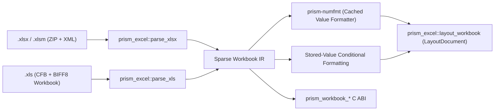

# Excel Architecture (`prism-excel` & `prism-numfmt`)

## Overview

`prism-excel` provides a sparse, forensically sound spreadsheet engine for both OOXML workbooks (`.xlsx`, `.xlsm`) and legacy binary Excel 97-2003 (`.xls`, `[MS-XLS]` BIFF8) files. It supports two complementary output modes:
1. **Paginated Print Layout** (`prism_excel::layout_workbook` → `LayoutDocument` → SVG / PNG / TIFF / PDF / HTML Viewer) honoring print areas, repeating title rows/columns, scale/fit-to-page, gridlines, row/column headings, conditional formatting, and anchored drawings/charts.
2. **Interactive Grid C ABI** (`prism_workbook_*` in `prism-bindings`) exposing sheet tabs (including `hidden` and `veryHidden`), compressed column spans, sparse cell tiles (`[r0..=r1, c0..=c1]`), formula inspection, deduplicated styles, floating charts/drawings, and cross-sheet search.

## Sparse Storage Model (ADR-0008)

Excel worksheets allow coordinates up to `1,048,576` rows × `16,384` columns (`XFD1048576`). Allocating dense 2D vectors for full-sheet formatting would exhaust gigabytes of memory. `prism-excel` stores:
- **`cells: BTreeMap<(u32, u32), Cell>`**: only populated cells allocate a `Cell` node, enabling fast range queries (`cells.range((r0, c0)..=(r1, c1))`) and `O(populated)` memory usage.
- **`col_spans: Vec<ColumnSpan>`**: compressed `[min_col..=max_col]` intervals for column widths, `hidden` flags, and default column styles.
- **`row_props: BTreeMap<u32, RowProps>`**: explicit row height, `hidden`, and outline level overrides.

## Forensic Invariants (Non-Negotiable)

1. **Never Recalculate Formulas**:
   - Formula cells (`<f>` in `.xlsx` or `FORMULA` `0x0006` in `.xls`) always display the **cached value** stored in the file (`<v>` or the 8-byte IEEE-754 / cached `STRING` record), formatted via [`prism-numfmt`](../../crates/prism-numfmt/src/lib.rs).
   - Volatile functions (`NOW()`, `TODAY()`, `RAND()`, `RANDBETWEEN()`, `INDIRECT()`, `OFFSET()`) never overwrite the stored evidence value.
   - Formulas lacking a cached value in the file are counted in [`WorkbookForensicFacts::formulas_without_cached_value`](../../crates/prism-excel/src/model.rs).
2. **Stored-Value Conditional Formatting (ADR-0009)**:
   - Value-based rules (`cellIs`, `containsText`, `top10`, `aboveAverage`, `duplicateValues`, `uniqueValues`, `colorScale`, `dataBar`, `iconSet`) are evaluated strictly against stored cell values.
   - Arbitrary formula rules (`type="expression"`) are **never** evaluated; they are recorded in `WorkbookForensicFacts::unevaluated_conditional_rules`.
3. **Hidden & Concealed Content**:
   - `hidden` and `veryHidden` worksheets (`state="hidden"`, `state="veryHidden"`, or BIFF8 `BOUNDSHEET8.hsState = 0x01 / 0x02`), hidden rows/columns, and cells concealed via `;;;` number formats (`prism_numfmt::is_concealed_format`) or matching font/fill colors are inventoried in `WorkbookForensicFacts` and surfaced when forensic visibility toggles are enabled.
4. **Zero Network / Process Activity**:
   - External workbook links (`xl/externalLinks`), web queries, DDE/OLE links, and `vbaProject.bin` are recorded in `WorkbookForensicFacts` and never executed or fetched.
