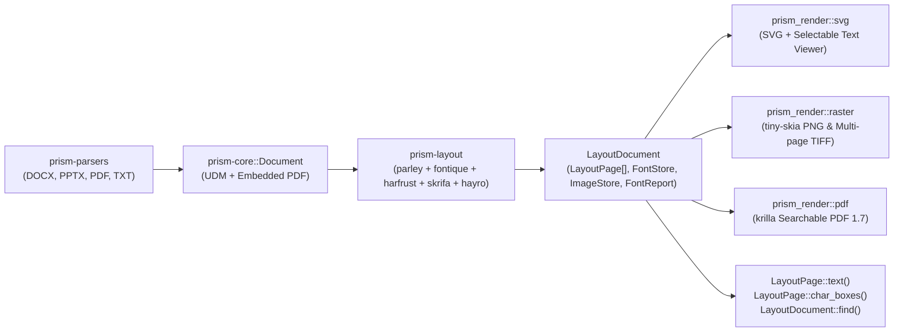

# `prism-layout` Architecture

`prism-layout` is Prism's deterministic, pure-Rust positioned page layout engine. Every paged document format (PPTX, DOCX, TXT, and PDF; XPS once its parser produces positioned blocks instead of generated HTML) is laid out into a single positioned representation ([`LayoutDocument`](../../crates/prism-layout/src/model.rs)), from which all visual and text outputs are produced.

## 1. Positioned Page Model (`prism_layout::model`)

- **Coordinate System**: All coordinates and dimensions are in typographic points (`1 pt = 1/72 inch`), with the origin `(0, 0)` at the **top-left** of the page and `+y` pointing downward.
- **Z-Order**: Items in `LayoutPage::items` are drawn in slice order.
- **Deterministic Serialization**: All collections in `FontStore`, `ImageStore`, and `FontReport` use `BTreeMap` / `BTreeSet` rather than `HashMap`, and all floating-point coordinates pass through `normalize_zero` (`-0.0 -> +0.0`) so serialized JSON, SVG, PNG, TIFF, and PDF outputs are byte-identical across runs and platforms.
- **Items**:
  - `Item::Glyphs(GlyphRun)`: Positioned glyph IDs (`PositionedGlyph`), font ID (`FontId`), size in points, color (`Rgba`), affine transform (`Affine`), original UTF-8 text (`text`), byte-to-glyph cluster mappings (`Vec<Cluster>`), decorations (`underline`, `strikethrough`, `highlight`), and provenance (`SourceRef`).
  - `Item::Path(PathItem)`: Vector paths (`MoveTo`, `LineTo`, `QuadTo`, `CurveTo`, `Close`) with solid or gradient fills (`FillPaint`), fill rules (`NonZero`, `EvenOdd`), and strokes (`StrokeStyle`).
  - `Item::Image(ImageItem)`: Deduplicated raster image reference (`ImageId`), destination rectangle, affine transform, opacity, and alt text.
  - `Item::Group(GroupItem)`: Hierarchical transform, clip path (`ClipPath`), and opacity group bounded by `LayoutOptions::max_recursion_depth`.
  - `Item::Link(LinkItem)`: Non-navigable link region (`rect` + `target`) surfaced for forensic inspection.
  - `Item::Anchor(AnchorItem)`: Named bookmark or annotation anchor.

## 2. Hermetic Font System (`prism_layout::fonts`)

- **Hermetic by Default**: `LayoutOptions::allow_system_fonts` defaults to `false`. Only fonts embedded in the document and Prism's bundled open-source fonts (`assets/fonts/`) are registered into `fontique::Collection`, guaranteeing identical line breaks and glyph metrics on every machine.
- **Bundled Font Suite (`assets/fonts/`)**:
  - **Carlito** (`Regular`, `Bold`, `Italic`, `BoldItalic`) — metric-compatible with Microsoft **Calibri**
  - **Caladea** (`Regular`, `Bold`, `Italic`, `BoldItalic`) — metric-compatible with Microsoft **Cambria**
  - **Liberation Sans** (`Regular`, `Bold`, `Italic`, `BoldItalic`) — metric-compatible with **Arial** / **Helvetica**
  - **Liberation Serif** (`Regular`, `Bold`, `Italic`, `BoldItalic`) — metric-compatible with **Times New Roman**
  - **Liberation Mono** (`Regular`, `Bold`, `Italic`, `BoldItalic`) — metric-compatible with **Courier New**
  - **Noto Sans** & **Noto Serif** (`Regular`, `Bold`, `Italic`, `BoldItalic`) — Pan-Unicode fallback
- **Embedded Fonts**:
  - DOCX obfuscated fonts (`word/fonts/*.odttf`) are deobfuscated via `deobfuscate_odttf` (XORing the first 32 bytes with the reversed 16-byte GUID key).
  - PDF embedded TrueType/OpenType/Type1/CFF fonts are extracted and their 1000-UPEM outlines cached via `skrifa` and `hayro-interpret`.
- **Substitution Audit Trail**: Every font request is recorded in `LayoutDocument::font_report` (`FontReport`), listing the requested family, resolved family, and `FontSourceKind` (`Embedded`, `Bundled`, `System`, or `SynthesizedOutlines`).

## 3. Text Shaping, Pagination & PDF Interpretation

- **Paragraph Shaping (`prism_layout::engine`)**: Built on `parley 0.12` + `harfrust` + `skrifa`. Supports mixed spans, bidirectional text (UAX #9), Unicode line breaking (UAX #14), alignment (`Left`, `Center`, `Right`, `Justify`), line spacing (`Multiple`, `Exact`, `AtLeast`), indents, tab stops, superscript/subscript, and run decorations.
- **UDM Layout (`prism_layout::udm`)**:
  - **Fixed-layout pages** (PPTX slides): Positions shapes, vector geometries, linear gradients, images, tables, and wrapped text boxes at their exact slide coordinates.
  - **Embedded markup is refused, not dropped.** Documents whose content is an embedded HTML or SVG block (email, MHT, HTML, EPUB, Markdown, SVG, and today XPS and DXF) make `layout_document` return `Error::UnsupportedFormat`; callers render them with `HtmlRenderer`.
  - **Flow-layout pages** (DOCX, TXT): Paginates paragraphs, lists, headings, images, and tables within section page dimensions and `PageMargins` (`<w:pgMar>`), splitting lines and table rows across page breaks.
- **Pure-Rust PDF Input (`prism_layout::pdf_input`)**: Uses `hayro-syntax` and `hayro-interpret` to interpret PDF page content streams directly into `LayoutPage` items without `pdf.js` or C/C++ libraries. Supports page-subset interpretation (`interpret_pdf_pages`) for fast first-page rendering on large PDFs.

## 4. Unified Text & Search Pipeline (`prism_layout::text_ops`)

All text operations derive from a single canonical walker (`LayoutPage::char_boxes`):
- `LayoutPage::text()` reconstructs reading-order text directly from the `CharBox` sequence, inserting spaces on horizontal word gaps and newlines on vertical baseline shifts.
- `LayoutPage::char_boxes()` returns the exact 1:1 `Vec<CharBox>` for every character in `LayoutPage::text()`.
- `LayoutDocument::find(query, SearchOptions)` searches across each page's `CharBox` stream (supporting `case_sensitive`, `ignore_diacritics`, and `whole_word`) and coalesces matched character boxes on the same line into `SearchHit::rects`.

## 5. Output Backends (`prism-render`)

- **`prism_render::svg`**: Emits standalone per-page `<svg>` documents with normalized 1000-UPEM glyph outlines in `<defs>` and `<use>` references, plus `render_document_viewer_html` which wraps pages in the offline interactive viewer (`crates/prism-render/assets/prism-viewer.js`, built from `viewer/src/prism-viewer.ts`) with virtualized page mounting, zoom, rotation, thumbnails, selectable text layer, and highlighted search hits.
- **`prism_render::raster`**: Rasterizes `LayoutPage`s on CPU via `tiny-skia` into deterministic PNG (`render_page_png`) and multi-page TIFF (`export_document_tiff`) buffers.
- **`prism_render::pdf`**: Exports any `LayoutDocument` to a deterministic, searchable PDF 1.7 document via `krilla` (`export_document_pdf`).

## 6. Page-on-Demand C ABI (`prism-bindings` & `bindings/c/prism.h`)

Native hosts (.NET, C/C++) can open a document once and render or query individual pages on demand:
- `prism_document_open` / `prism_document_close`
- `prism_document_page_count` / `prism_document_page_size`
- `prism_document_render_page` (`PRISM_PAGE_FORMAT_SVG`, `PRISM_PAGE_FORMAT_PNG`, `PRISM_PAGE_FORMAT_VIEWER_FRAGMENT`)
- `prism_document_page_text` / `prism_document_search` / `prism_document_font_report`
- `prism_document_export` (`PRISM_EXPORT_FORMAT_PDF`, `PRISM_EXPORT_FORMAT_TIFF`, `PRISM_EXPORT_FORMAT_HTML_VIEWER`)
- `prism_buffer_free`
