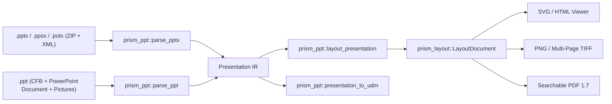

# PowerPoint Architecture (`prism-ppt` & `prism-drawingml`)

## Overview

`prism-ppt` provides native, deterministic parsing and fixed-coordinate slide layout for both OOXML presentations (`.pptx`, `.ppsx`, `.potx`) and legacy binary PowerPoint 97-2003 (`.ppt`, `[MS-PPT]` + `[MS-ODRAW]`) decks. Every presentation is lowered into a rich [`Presentation`](../../crates/prism-ppt/src/model.rs) intermediate representation and rendered directly into a [`prism_layout::LayoutDocument`](../../crates/prism-layout/src/model.rs) without passing through lossy HTML or UDM intermediates.

## 3-Level Slide Inheritance (`SlideMaster` → `SlideLayout` → `Slide`)

Per ADR-0007 and ECMA-376 §19.3, slide rendering resolves properties across three hierarchical layers:
1. **`SlideMaster`** (`ppt/slideMasters/slideMaster*.xml` / `MainMaster` container): defines default background fills, color map (`<p:clrMap>`), master decorative shapes, and `txStyles` (`titleStyle`, `bodyStyle`, `otherStyle`).
2. **`SlideLayout`** (`ppt/slideLayouts/slideLayout*.xml`): inherits or overrides the master background and defines placeholder geometry (`<p:ph type="..." idx="..."/>`) and per-level text defaults.
3. **`Slide`** (`ppt/slides/slide*.xml` / `Slide` container): inherits its layout's placeholder bounding boxes (`x`, `y`, `width`, `height`), background (unless `showMasterBg="0"`), and decorative master/layout shapes (unless `showMasterSp="0"`).

## Shared `DrawingML` Engine (`prism-drawingml`)

`prism-ppt`, `prism-excel`, and `prism-word` share [`prism-drawingml`](../../crates/prism-drawingml/src/lib.rs) for:
- **Theme & Color Pipeline** ([`theme.rs`](../../crates/prism-drawingml/src/theme.rs)): 12-slot `a:clrScheme` (`dk1`, `lt1`, `dk2`, `lt2`, `accent1..6`, `hlink`, `folHlink`), `a:fontScheme` (`majorFont`, `minorFont`), and exact RGB/HSL color transforms (`tint`, `shade`, `lumMod`, `lumOff`, `satMod`, `satOff`, `alpha`).
- **Preset & Custom Geometry** ([`geometry.rs`](../../crates/prism-drawingml/src/geometry.rs)): all 187 ECMA-376 preset geometries (`prstGeom`) and custom geometries (`custGeom`) with the 17-operator guide formula evaluator (`+-`, `*/`, `?:`, `abs`, `at2`, `cat2`, `cos`, `max`, `min`, `mod`, `pin`, `sat2`, `sin`, `sqrt`, `tan`, `val`).
- **Native Charts** ([`chart.rs`](../../crates/prism-drawingml/src/chart.rs)): `c:chartSpace` and `cx:chartSpace` rendered directly from cached series values.

## Forensic Invariants

- **Hidden Slides**: slides with `show="0"` or binary hidden flags are parsed and recorded in [`PresentationForensicFacts::hidden_slide_numbers`](../../crates/prism-ppt/src/model.rs). When `LayoutOptions::show_hidden_text` is enabled (`MarkupMode::AllMarkup`), hidden slides are emitted with a `[HIDDEN SLIDE]` forensic badge.
- **Speaker Notes & Comments**: speaker notes (`ppt/notesSlides/notesSlide*.xml` / `Notes` atoms) and slide comments (`ppt/comments/comment*.xml` + modern `p188:cmLst`) can be appended or inspected without mutating slide geometry.
- **Never Execute Actions**: `ppaction://program`, `ppaction://macro`, OLE verbs, and external hyperlinks are never executed or fetched; all targets are recorded in `PresentationForensicFacts`.
